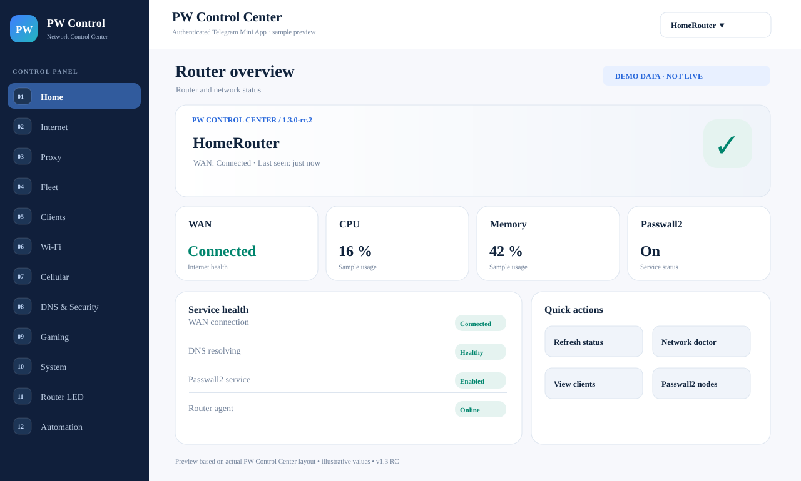
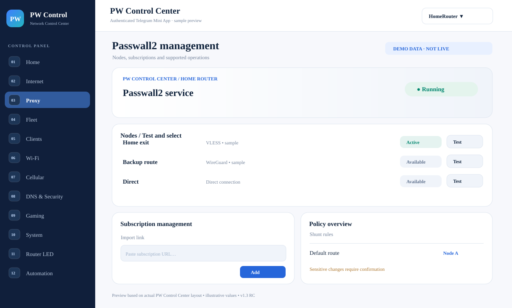
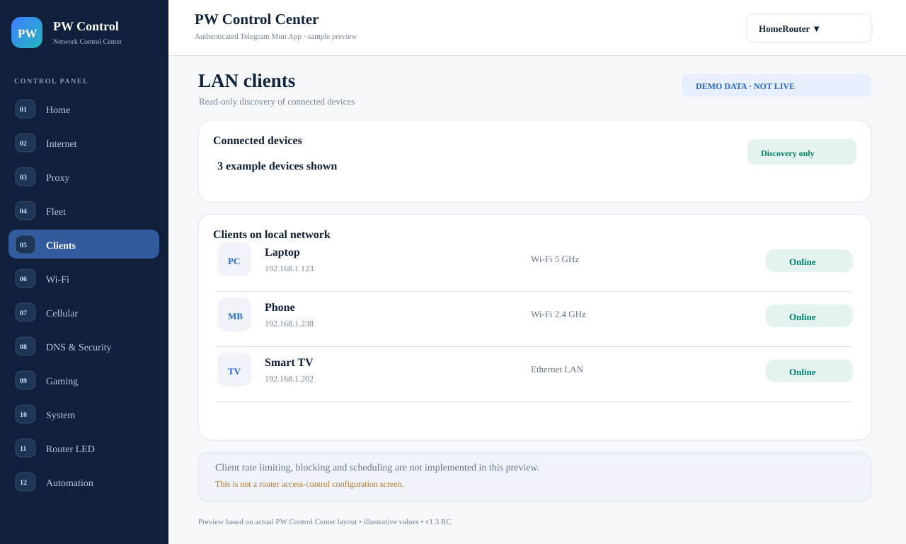
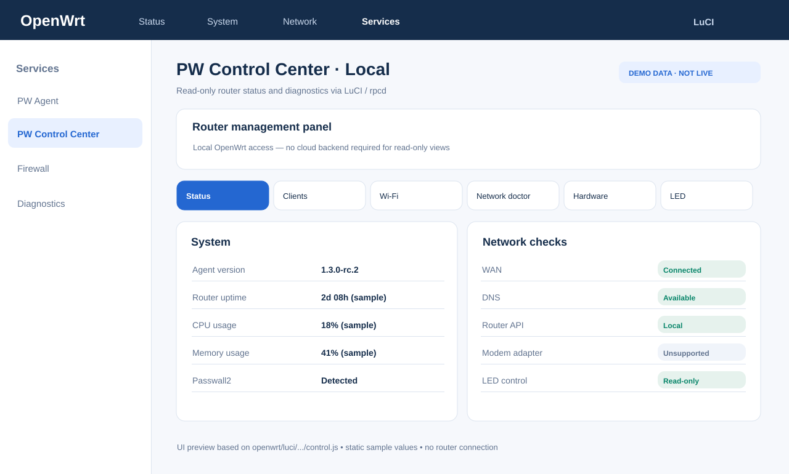

# PW Agent — OpenWrt Network Control Center

**OpenWrt + Passwall2 · Telegram Mini App · Local LuCI · cPanel PHP/MySQL**

[GitHub Latest: v1.4.0-alpha.1 (NOT stable)](https://github.com/aliazizi0906/Passwall-Agent-Telegram-Bot/releases/latest) · [Previous production baseline: v0.6.0](https://github.com/aliazizi0906/Passwall-Agent-Telegram-Bot/releases/tag/v0.6.0) · [فارسی](#فارسی) · [Install v1.3 RC](docs/en/INSTALL_V1_3.md) · [Upgrade from v0.6](docs/en/UPGRADE_V1_3.md) · [Implementation status](docs/en/CONTROL_CENTER_PROGRESS.md) · [Changelog](CHANGELOG.md)

> **Public release status:** `v1.4.0-alpha.1` is deliberately published as **GitHub Latest**, but its `alpha.1` label means it is **NOT Stable/GA or production-certified**. Do not deploy it on essential routers without an isolated staging setup, verified backups, and a tested recovery path. The `v0.6.0` release remains the previous stable baseline; `v1.3.0-rc.2` is an older release candidate.

## v1.4.0-alpha.1 — public Alpha (GitHub Latest)

The next implementation branch adds **independent web username/password login** during cPanel setup, hardened session/CSRF protection, Owner-only credential recovery from Telegram, redesigned control-center surfaces, pinned Vazirmatn with a self-hosted font in packaged ZIPs, safer bootstrap download, broader OpenWrt CPU builds, **Owner-approved staged Fleet rollouts, an additive MySQL migration ledger, reversible LED identification**, and a **read-only DNS/IPv6 egress audit**. These changes are included in the **signed v1.4.0-alpha.1 public download**. **Latest is not Stable:** use staging and a noncritical router, and do not assume full 14-feature or all-hardware support.

[v1.4 Alpha release notes and download](https://github.com/aliazizi0906/Passwall-Agent-Telegram-Bot/releases/tag/v1.4.0-alpha.1) · [Full 14-workstream implementation matrix](docs/en/V1_4_EXECUTION.md) / [وضعیت اجرایی همه ۱۴ بخش](docs/fa/V1_4_EXECUTION.md).

### v1.4 Alpha cPanel setup (staging only)

1. Download `pw-agent-cpanel-v1.4.0-alpha.1.zip`, plus its SHA256 and signature, from the [latest release](https://github.com/aliazizi0906/Passwall-Agent-Telegram-Bot/releases/latest).
2. Extract to a **new staging directory** on cPanel. Set the secure web username and password during `setup.php` (requires PHP 8.1+, HTTPS and MySQL).
3. Open `/auth/login.php` for browser sign-in and `/control/` for router management. Run version-pinned provisioning only on a noncritical router with OpenSSL signature-verification tools.
4. Always inspect [the alpha release warnings](docs/en/RELEASE_NOTES_V1_4_ALPHA_LATEST.md). No automatic upgrade of existing production installs is performed.

## What is PW Agent?

PW Agent is a self-hosted management stack for OpenWrt routers running Passwall2. The router initiates authenticated outbound HTTPS/HMAC requests to a PHP/MySQL backend, so no public IP or WAN management port is required. The backend can run on cPanel shared hosting without a Node.js runtime or hosting-side SSH.

## Earlier v1.3.0-rc.2 preview (historical)

- **Telegram PW Control Center:** Persian/English, RTL/LTR, light/dark UI, router selection, real monitoring data and history, health checks.
- **Passwall2 tools:** view/test/select nodes, import links, manage subscriptions and inspect Shunt/relay status with server-side validation and device-scoped permissions.
- **Local LuCI panel:** offline read-only router/system status, LAN clients, Wi-Fi, Network Doctor, capability discovery and optional GoogleWifiLED status.
- **Agent diagnostics:** `agent.capabilities`, `network.doctor`, `led.status` plus JSON CLI views.
- **Existing platform:** fleet, RBAC, audit, monitoring/alerts, schedules, backups and signed Agent update support.
- **Release assets:** cPanel ZIP plus six OpenWrt architectures, each with SHA256 and Ed25519 signature.

### UI previews / پیش‌نمایش محیط کاربری

These **documentation-only static previews** follow the actual PW Control Center layout and color tokens in `server/control/index.php`. Values and names are illustrative sample data, **not live router screenshots or proof of implemented controls**. The operational UI requires authentication inside Telegram; LuCI runs locally on OpenWrt.

تصاویر زیر **پیش‌نمایش ثابت و نمونه‌ای** بر پایه کد رابط کاربری همین مخزن هستند؛ اطلاعات روتر، IP و مقادیر صرفاً مثال‌اند و اسکرین‌شاتِ اتصال واقعی محسوب نمی‌شوند.



| Passwall2 node & subscription UI | LAN client discovery UI |
|:---:|:---:|
|  |  |

**Local LuCI preview / پیش‌نمایش پنل محلی:**



### Known release limits

This is a release candidate. Per-client traffic shaping/blocking, robust WAN/Wi-Fi/firewall safe-apply rollback, leak-proof IPv6/DNS kill switch, cellular tower/band lock and SMS/USSD, RGB LED writes, production SQM/UPnP controls, native VPN adapters and standalone browser login are **not complete or hardware-certified**. Do not infer these capabilities from a roadmap or UI mockup. See the [implementation matrix](docs/en/CONTROL_CENTER_PROGRESS.md).

## Older v1.3.0-rc.2 installation (historical; staging only)

1. Read the [full installation guide](docs/en/INSTALL_V1_3.md) or [راهنمای فارسی](docs/fa/INSTALL_V1_3.md).
2. Download [`pw-agent-cpanel-v1.3.0-rc.2.zip`](https://github.com/aliazizi0906/Passwall-Agent-Telegram-Bot/releases/download/v1.3.0-rc.2/pw-agent-cpanel-v1.3.0-rc.2.zip) and verify its published SHA256/signature.
3. In cPanel File Manager, extract the ZIP **directly into an isolated staging directory**. It contains `setup.php`, `api/`, `control/` and related files at the archive root.
4. Create a separate staging database and Telegram Bot, then open `https://YOUR-DOMAIN/YOUR-PATH/setup.php`.
5. Configure cPanel Cron as documented and run the one-time provisioning command generated by Setup on a noncritical test router.
6. Open the new panel inside the authorized Telegram Mini App and inspect local *LuCI → Services → PW Control Center*.

**Do not run this RC against production without a tested backup and rollback.** Never reuse your production Telegram Bot for staging, delete `config.php`, or expose tokens/database dumps.

For the stable v0.6.0 installer, use the [legacy installation guide](docs/en/INSTALL.md) and select the matching v0.6.0 release asset. Existing v0.6 deployments should follow the [v0.6 → v1.3 RC migration guide](docs/en/UPGRADE_V1_3.md); do not rerun Setup as an upgrade.

## Architecture

```text
Telegram Mini App / Bot
        │ HTTPS
        ▼
PHP Backend + MySQL + Cron
        ▲
        │ outbound HTTPS + HMAC
        ▼
Go Agent on OpenWrt ── Passwall2 / UCI / ubus / procd
        │
        └── Local read-only LuCI Control Center
```

## Documentation

| Guide | Description |
|---|---|
| [English v1.3 RC installation](docs/en/INSTALL_V1_3.md) / [فارسی](docs/fa/INSTALL_V1_3.md) | New staging install |
| [English upgrade guide](docs/en/UPGRADE_V1_3.md) / [فارسی](docs/fa/UPGRADE_V1_3.md) | Safe migration from v0.6 with backup/rollback |
| [Implementation matrix](docs/en/CONTROL_CENTER_PROGRESS.md) / [وضعیت فارسی](docs/fa/CONTROL_CENTER_PROGRESS.md) | Implemented vs incomplete |
| [Features](docs/en/FEATURES.md) / [قابلیت‌ها](docs/fa/FEATURES.md) | Baseline and legacy capabilities |
| [Architecture](docs/en/ARCHITECTURE.md) / [معماری](docs/fa/ARCHITECTURE.md) | Components and request flow |
| [Security](docs/en/SECURITY.md) / [امنیت](docs/fa/SECURITY.md) | HMAC, secrets, signatures and provisioning |
| [Updates](docs/en/UPDATES.md) / [به‌روزرسانی](docs/fa/UPDATES.md) | Release and update process |
| [Development](docs/en/DEVELOPMENT.md) / [توسعه](docs/fa/DEVELOPMENT.md) | Local build, tests and CI |
| [Release notes EN](docs/en/RELEASE_NOTES_V1_3_RC.md) / [یادداشت فارسی](docs/fa/RELEASE_NOTES_V1_3_RC.md) | RC2 scope and release boundaries |
| [Repository structure](docs/REPOSITORY_STRUCTURE.md) | Source layout, retention decisions and UI preview provenance |
| [Changelog](CHANGELOG.md) | Versioned history |

## Build and validate

```sh
gofmt -l *.go
go test ./...
go vet ./...
find server -name '*.php' -print0 | xargs -0 -n1 php -l
php server/tests/setup_core_test.php
php server/tests/v130_command_validation_test.php
python3 scripts/check_dashboard_js.py
node --check openwrt/luci/www/luci-static/resources/view/pw-agent/control.js
sh -n openwrt/install-remote.sh
sh -n openwrt/install.sh
sh -n openwrt/install-update.sh
bash scripts/package_cpanel.sh
```

---

## فارسی

**PW Agent** سامانه مدیریت Self-hosted برای روترهای OpenWrt و Passwall2 است. روتر با درخواست‌های خروجی HTTPS/HMAC به Backend مبتنی بر PHP/MySQL متصل می‌شود؛ بنابراین به IP عمومی یا پورت مدیریتی باز روی WAN نیاز نیست. Backend روی cPanel و بدون Node.js قابل اجراست.

### وضعیت انتشار

- **جدیدترین نسخه عمومی GitHub Latest:** `v1.4.0-alpha.1` — نسخه Alpha و **غیرپایدار**؛ برای تست در Staging.
- **آخرین نسخه پایدار:** `v0.6.0`.
- نسخه `v1.3.0` هنوز Stable/GA نیست؛ نصب RC فقط برای Staging و روتر آزمایشی توصیه می‌شود.

### قابلیت‌های نسخه آزمایشی ۱.۳

- پنل PW Control Center داخل Telegram Mini App با فارسی/انگلیسی، RTL/LTR و تم روشن/تاریک.
- نمایش داده واقعی Monitoring، تاریخچه Metrics، وضعیت روتر و انتخاب دستگاه.
- ابزارهای Passwall2 برای مشاهده/تست/انتخاب Node، ورود لینک و مدیریت Subscription با کنترل مجوزها.
- پنل محلی LuCI با وضعیت سیستم، Wi-Fi، دستگاه‌های LAN، Network Doctor و شناسایی قابلیت سخت‌افزار؛ این بخش برای مشاهده وضعیت به Backend وابسته نیست.
- نسخه‌های امضاشده Agent برای شش معماری و ZIP نصب Backend برای cPanel.

**موارد ناقص:** محدودسازی سرعت یا قطع اینترنت هر کلاینت، Rollback امن تغییرات WAN/Wi-Fi/Firewall، Kill Switch تضمین‌شده DNS/IPv6، کنترل باند/دکل مودم و SMS/USSD، تغییر رنگ RGB LED، SQM/UPnP پیشرفته و ورود مستقل مرورگر هنوز کامل یا روی سخت‌افزار واقعی تأیید نشده‌اند. [جدول وضعیت کامل](docs/fa/CONTROL_CENTER_PROGRESS.md)

### نصب نسخه ۱.۳ RC

۱. [راهنمای نصب کامل فارسی](docs/fa/INSTALL_V1_3.md) را بخوان.
۲. [ZIP مخصوص cPanel نسخه RC2](https://github.com/aliazizi0906/Passwall-Agent-Telegram-Bot/releases/download/v1.3.0-rc.2/pw-agent-cpanel-v1.3.0-rc.2.zip) را از Release دریافت و SHA256/امضا را بررسی کن.
۳. ZIP را مستقیماً داخل یک پوشه Staging در cPanel استخراج کن؛ فایل `setup.php` باید در ریشه همان پوشه باشد.
۴. Database و Telegram Bot آزمایشی جدا بساز و Setup را اجرا کن.
۵. Cron را طبق راهنما تنظیم و فرمان Provisioning تولیدشده را روی یک روتر غیرحیاتی اجرا کن.
۶. پنل را داخل Telegram Mini App و بخش *LuCI → Services → PW Control Center* بررسی کن.

**روی سرور اصلی یا روتر حیاتی، بدون Backup و Rollback آزمایش‌شده نصب نکن.** فایل `config.php` و Tokenها را حذف یا منتشر نکن.

برای نصب پایدار `v0.6.0` از [راهنمای قدیمی نصب](docs/fa/INSTALL.md) و Asset هم‌نسخه استفاده کن. برای ارتقا از v0.6، [راهنمای مهاجرت RC](docs/fa/UPGRADE_V1_3.md) را دنبال کن؛ Setup نصب تازه را به‌عنوان روش Upgrade اجرا نکن.

### مستندات مهم

- [نصب نسخه ۱.۳](docs/fa/INSTALL_V1_3.md)
- [ارتقا از v0.6 به v1.3 RC](docs/fa/UPGRADE_V1_3.md)
- [وضعیت پیاده‌سازی و قابلیت‌های ناقص](docs/fa/CONTROL_CENTER_PROGRESS.md)
- [معماری](docs/fa/ARCHITECTURE.md) · [امنیت](docs/fa/SECURITY.md) · [به‌روزرسانی](docs/fa/UPDATES.md)
- [Changelog](CHANGELOG.md) · [صفحه Releases](https://github.com/aliazizi0906/Passwall-Agent-Telegram-Bot/releases)

### تست و Build

دستورهای Go، PHP، JavaScript و Shell بالا برای تست محلی در بخش انگلیسی آمده‌اند. CI نسخه RC2 نیز تست‌ها و بسته‌های Release را تولید می‌کند.

**تاریخچه نسخه‌ها:** عبارت‌های `v0.6` در فایل‌های `features_v060.go`، Changelog و راهنماهای Legacy برای توصیف قابلیت‌های تاریخی یا مسیر مهاجرت حفظ شده‌اند؛ این موارد به معنی منتشرنشدن RC2 نیستند.
