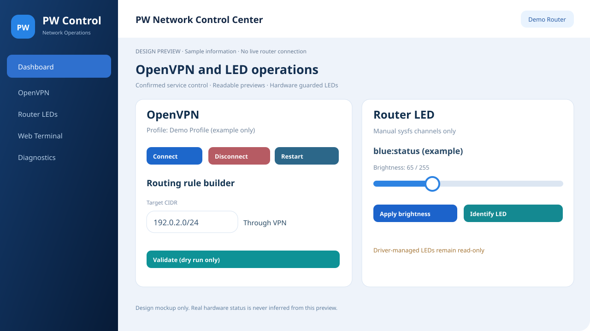
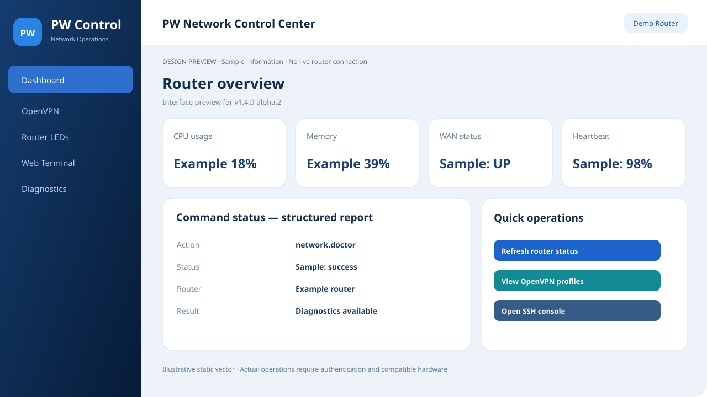

# PW Agent v1.4 development status (not a public release)

Development source branch: `feature/v1.4-secure-browser-control`. **v1.4.0-alpha.2 is the GitHub Latest public download, but is NOT stable or production-certified.** Public distribution does not imply the 14 workstreams are complete.

## Implemented and under CI

- Security hardening: device detail and update API responses now use a strict public-field allowlist rather than exposing `secret_sealed` or raw metadata; CI validates redaction.
- Secure independent web username/password set by cPanel Web Setup; hashed credentials, HTTPS session, CSRF, RBAC/device scoping, rate-limited login, idle timeout, credential reset/revocation by Telegram Owner. Sessions without their original password fingerprint now fail closed, including after password rotation.
- Refreshed RTL/LTR web UI, native SVG navigation, a mobile drawer with keyboard/Escape closing, responsive network cards, two-column secure browser login and password-visibility toggle served from an external script allowed by CSP.
- Pinned Vazirmatn font with local verified WOFF2 inside the cPanel build, pinned CDN fallback and system-font final fallback. No runtime Node.js.
- More OpenWrt CPU targets; Passwall2 optional for generic OpenWrt functions, hardware capabilities explicitly checked. `agent.capabilities` exposes honest per-router `feature_support` statuses (`available`, `read_only`, `not_available`, `planned`) rather than assuming that a service or RGB/4G driver exists for every model.
- **cPanel-hosted router bootstrap:** the signed initial installer is bundled at `/install/remote.sh`; token-authorized, POST-only cPanel cache can stream architecture-specific signed archives before consuming the one-time provisioning token. GitHub Release is a fallback when the cache is unavailable. The router still checks SHA256 and **Ed25519 signatures** with its pinned key; `openssl`, `base64` and `sha256sum` are required.
- Fixed-provider opt-in download probe capped at 2 MiB per run, cooldown enforced; provider receives router public IP. Not a real full-speed or bufferbloat measurement.
- Read-only ModemManager/uqmi signal discovery (no IMEI/IMSI/SMS), UCI SQM/UPnP status, generic sysfs LED inventory, and local LuCI tabs. DNS encryption tools, Adblock, DDNS, mwan3 and VLAN configurations are also discovered without exposing credentials.
- **Owner-approved Fleet canary rollouts:** first router only, manual approval before each subsequent wave, command-status and fresh heartbeat verification, pause on failures/offline, cancel/resume controls and persisted MySQL audit. Queued commands cannot be revoked; full fleet rollback remains pending.
- **Hardware-independent LED identification and guarded brightness writes:** a 1.2-second temporary sysfs brightness pulse with deferred restore, rejecting OS-managed LED triggers; this is not RGB scheduling.
- **Static DNS/IPv6 egress audit:** checks public IPv6 route/address and resolver count, while explicitly returning `verified_no_leak=false` and `kill_switch_verified=false` until external path tests exist.
- CI checks Go compilation and tests, PHP syntax, MySQL authentication and rollout behavior, JS, release signing fixture and cPanel packaging.

- Safe per-client policy planning: validates unicast 48-bit MAC, requested block/unblock/speed-limit policy and numeric limits; **never** writes firewall or traffic shaping rules before recovery support exists.

## The 14 workstreams

| # | Workstream | Current status |
|---|---|---|
| 1 | Installation, backend migration, updater and rollback | Signed first install, guarded initial OpenWrt preflight, staged Agent/init/config replacement with error rollback, and additive/versioned MySQL migration ledger implemented; power-loss recovery, LuCI rollback, staged PHP backend upgrade and full rollback still pending |
| 2 | Per-client blocking, quotas and schedules | Validated MAC-based Block/Unblock/Rate-limit dry-run form and command added; real nftables/tc enforcement, schedules and local timed rollback still pending |
| 3 | Wi-Fi password, SSID, channel, guest and QR | Named UCI SSID diff/dry-run form added, without applying changes; independent timed rollback still pending |
| 4 | VPN kill switch, Iran/direct split, DNS/IPv6 leak | Read-only IPv6/DNS risk indicators added; actual leak verification, kill switch and policy engine pending |
| 5 | Split/encrypted DNS and ad blocking | DNS diagnostics and optional resolver/adblock service inventory; safe resolver adapters pending |
| 6 | SQM/QoS, UPnP, NAT and gaming | Read-only SQM/UPnP inventory added; safe configuration and bufferbloat pending |
| 7 | Speed tests, bandwidth history and per-client usage | Capped 2 MiB download probe added; upload, full-speed and per-client counters pending |
| 8 | LuCI and responsive PW Control UI | Enhanced web UI, new read-only LuCI tabs; safe hardware writes pending |
| 9 | Standalone web login | Implemented in staging; security review and deployment testing pending |
| 10 | Router LED / RGB | Generic sysfs inventory and 1.2-second reversible LED identify added; RGB schedule and hardware-specific controls pending |
| 11 | Passwall2, WireGuard, OpenVPN and failover | Existing Passwall2 tools preserved; native VPN-provider and route tests pending |
| 12 | Cellular, band/cell lock and SMS/USSD | Read-only QMI/ModemManager signal inventory added; privileged modem adapters pending |
| 13 | Fleet canary, rollout and rollback | Owner-approved rollout waves and monitoring added; automatic fleet rollback and real-device acceptance tests pending |
| 14 | CI, incident recovery, security review and stable release | Automated tests expanded; real multi-router upgrade/recovery acceptance testing pending |

## Alpha.2 actionable additions

The web panel now offers **OpenVPN service start/stop/restart** when OpenVPN is installed and the user has `network.modify`, a CIDR rule builder **dry-run only**, manual sysfs LED brightness change when the kernel trigger is `none`, and a permission-scoped embedded browser SSH console. Browser SSH requires independent web login, `terminal.execute` and separate router credentials. Unsupported/hardware-managed functions remain read-only.





## Cross-device compatibility policy

No hardware-specific control can be promised for every OpenWrt router. The Agent detects available Wi-Fi, WAN, Passwall2, LED, modem and SQM providers and returns unavailable rather than guessing. Features that modify connectivity **must not be enabled** until a local-independent rollback path and representative hardware tests exist.

## How to verify

Open [PR #8](https://github.com/aliazizi0906/Passwall-Agent-Telegram-Bot/pull/8) and review its CI results, staging asset and changed files. To create an offline development test bundle:

```sh
go test ./...
go vet ./...
python3 scripts/check_dashboard_js.py
php server/tests/web_auth_test.php
bash scripts/package_cpanel.sh
```

Only use the version-pinned, Ed25519-signed GitHub alpha release and verify `openssl-util` before provisioning on a noncritical test router. CI artifacts are not substitutes for signed public release assets. No production deployment or full hardware certification is claimed.
